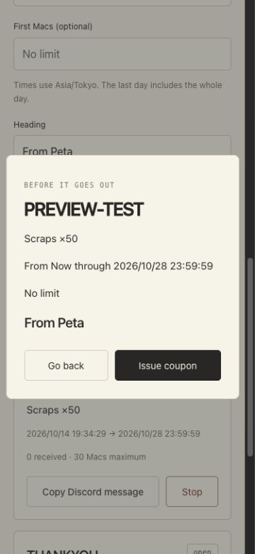

# 管理ページの実装報告

2026-10-14。`docs/archive/prompts/codex-admin-page-prompt.md` を実装しました。本番のデプロイ、Cloudflare/Zero Trust の変更、秘密鍵・API トークンの実登録は行っていません。

## 実装内容

- **Step 1**: `COUPON_KEYS` を `KEYS` と分離。c1 は公開 RFC 8032 テスト公開鍵をテスト／developer のときだけ信用します。c2 はオーナーが追加する TODO を残しています。クーポン鍵の解決はイベントだけで行い、通常の署名ファイル・PETA1 のスロット・公式 k* の権限を変えていません。bundle 以外、添付、余分な本体を拒否し、既存の grant_cap / check_grants / apply_grants を使います。
- **Step 2**: 別の `peta-admin` Worker、dev/prod 設定、D1/R2、静的ファイルにも先行する認証。Access 検証と emailHash は `cloudflare/shared` で共有し、peta-download の既存テストも通しています。OWNER_EMAILS の検査、全要求の JWT 検証、同一 Origin の JSON POST、同じ強さの CSP、no-store、監査表を追加しました。0007 は既存の表を変えず `admin_log` と `admin_locks` を追加します。
- **Step 3**: Worker で Ed25519 seed を PKCS#8 に包み、PETAEVNT v1 を Rust serde の並びと同じに組み立てて署名。固定日時・公開 RFC テスト鍵の契約ファイルを Worker が照合し、Rust が署名検証 → decode → apply_event、再エンコードのバイト一致、全19項目の上限一致を確認します。
- **Step 4**: クーポン API とフォーム、種類別の選択肢・上限・10行制限・重複拒否、端末時間帯での期間入力、発行前確認、Discord 投稿文コピー、既存の手元署名クーポンを含む一覧、各状態、個別停止／確認付き全部停止。発行・停止・監査は D1 batch で同時に記録します。既存の peta-api の署名付き受け取り API に実際に管理 Worker の出力を渡すテストを追加しました。
- **Step 5**: 再利用可能 Peta friends ポリシーの GET → PUT → GET 確認。メールの正規化・形式検査・重複拒否・200件制限・全オーナーメールの削除保護。ほかの更新可能項目を保持し、読み取り専用項目は送信しません。複数 Worker／タブの変更を D1 リースで直列化し、古い一覧からの操作は409。削除は招待を先に止め、初回未訪問にも停止済み行を作ります。Cloudflare の失敗は状態と数値コードのみ監査し、画面には秘密を含まない部分成功／再試行の案内を出します。Friends 画面で招待状態・Mac 利用開始・最終ダウンロード版と日時、招待の停止／再開、招待文コピーを実装しました。
- **Step 6**: R2 の最新 manifest を読む配布状況と、版ごとのユニークメールハッシュ数／回数。DMG アップロードなし。外部スクリプト・フォントなし。375px のブラウザで3タブ・フォーム・確認画面・コピー・友達追加削除を見本データで操作し、横スクロールなし・コンソールエラーなしを確認しました。
- **Step 7**: オーナー専用 `coupon-key.sh`、セットアップ・移行・デプロイ・緊急停止手順、既存手順書からのリンク。生成した seed はメモリと Wrangler の標準入力のみ。既存 secret の上書きに端末確認を要求し、公開鍵だけ表示します。偽の Wrangler によるテストで、dev/prod、宛先、失敗時の秘密出力抑制、既存 secret の保護を確認しました。最終レビューで壊れた旧クーポンの表示を隔離し、不在メールの削除／存在しない招待の再開を拒否するようにしました。追加の非秘密 var `COUPON_PUBLIC_KEY` で、署名鍵とアプリに入れる公開鍵の不一致を発行前に拒否します。

既存の `peta-api` の受け取り処理・マイグレーション0001〜0006、`coupon.py`、`peta-pass`、`publish-release.sh`、公式鍵配列 KEYS の挙動は変更していません。作業前から存在した未追跡のアートや UI 提案ファイルはコミットに含めていません。

## 確認した Cloudflare API

2026-10-14 に公式ドキュメントで次を確認しました。

- [Get an Access reusable policy](https://developers.cloudflare.com/api/resources/zero_trust/subresources/access/subresources/policies/methods/get/): GET `/accounts/{account_id}/access/policies/{policy_id}`。
- [Update an Access reusable policy](https://developers.cloudflare.com/api/resources/zero_trust/subresources/access/subresources/policies/methods/update/): PUT 同じパス。Include のメール規則は `{"email":{"email":"..."}}`。必要権限は `Access: Apps and Policies Write`（トークン作成画面では Edit）。decision/name/include に加え exclude/require、承認、接続、MFA、理由入力、セッションなどの更新可能項目を保持。
- [Access policy management](https://developers.cloudflare.com/cloudflare-one/access-controls/policies/policy-management/): 再利用可能ポリシーの管理。
- [Access session management](https://developers.cloudflare.com/cloudflare-one/access-controls/access-settings/session-management/): ポリシー変更時の既存セッションの寿命。

## テスト結果

各 Step のコミット前に、指定された Worker テスト・型チェック、Rust workspace server/default、フロントエンドテストを実行しました。Step 1 の時点ではまだ peta-admin が存在しないため、それ以外を実行し、Step 2 から管理 Worker も毎回実行しています。途中の型・テスト入力・契約ファイル参照の不備は修正して再確認しました。Step 6 の最終再検証時に Rust のアーカイブ作成がディスク容量不足で停止しましたが、開発用アプリ本体の生成キャッシュだけを整理し、同じ全テストを再実行して成功しました。配布版の成果物は削除していません。

最終 Step 7 の独立検証結果（すべて終了コード0）:

| 検証 | 結果 |
|---|---|
| peta-admin npm test / tsc --noEmit | 5ファイル・21テスト成功 / 型エラーなし |
| peta-download npm test / tsc --noEmit | 8テスト成功 / 型エラーなし |
| peta-api npm test / tsc --noEmit | 66テスト成功 / 型エラーなし |
| Rust workspace --features server | 全体295テスト成功、既存の実サーバー用3件は ignore のまま |
| Rust workspace（追加 feature なし） | 全体287テスト成功（core は260件）、失敗なし |
| Rust core --features developer --test official_trust | 2テスト成功。c1 の Developer 信用と一般形式の拒否を確認 |
| ルート npm test | 209テスト成功、失敗／skipなし（鍵スクリプトの3件を含む） |
| bash -n / 各画面 JS の構文 / git diff --check | すべて成功 |
| Wrangler deploy --dry-run --env dev / prod | 両方成功、7静的ファイルを含めて組み立て、デプロイなし |

Rust の3件の ignore は既存の inbox_live_round_trip / gift_take_back_live / market_live_round_trip です。実サーバーへアクセスするため、この作業では追加実行していません。最終実行では各 Rust 構成の前にアプリ本体の開発キャッシュだけを整理し、容量不足を避けています。ローカルテストログは `/private/tmp/peta-admin-step7-*.log`。

スマホ画面（実データではないローカル見本）:

## オーナーが行うこと（順番）

詳しい操作・コマンドは [admin-page-howto.md](../../admin-page-howto.md)。

1. `peta-admin` に npm ci、Wrangler のログイン。
2. dev/prod の D1 に0007を適用。
3. 認証設定が空の状態で初回 Worker をデプロイ（全員403）。
4. 管理専用 Access アプリケーション、Peta owner＝自分のメールだけ、One-time PIN を設定。管理用 AUD を取得。
5. ダウンロード側 Peta friends が再利用可能ポリシーであることと、ダウンロード用アプリケーションへの関連付けを確認。ID を控え、自分のメールも1件残す。
6. 対象アカウントの Access: Apps and Policies Edit だけのトークンを作り、CF_API_TOKEN secret を登録。
7. 各環境の Access/AUD/OWNER_EMAILS/CF_ACCOUNT_ID/ポリシーID を設定。
8. coupon-key.sh dev/prod を手動実行。秘密を共有せず、表示された公開鍵だけを扱う。
9. prod の公開鍵をアプリの COUPON_KEYS 末尾に c2 として追加し、同じ値を COUPON_PUBLIC_KEY、ID を COUPON_KEY_ID に入れる。更新したアプリを配る。
10. 管理 Worker を再デプロイし、dev の Peta Developer で Redeem Code… を試してから本番運用へ進む。

## 未確認・既存動作による制限

- 実 Cloudflare アカウントのポリシー変更、実 Access ログイン、本番 D1/R2、実トークン・secret 登録、デプロイは未実施。Cloudflare API 操作は依存注入による差し替えで検証しました。
- Peta Developer の実画面で Redeem Code… を手操作していません。**契約テストと既存 peta-api の署名付き受け取り API との連携テストで代替**しています。本番 c2 の公開鍵はオーナーが作るため、現時点ではアプリにありません。
- 既存の Access セッションは、メール削除後も期限までページの外枠を表示できる場合があります。D1 の招待停止で DMG とアプリの新しい通信は拒否します。必要ならオーナーが Access のセッション失効も行います。peta-download の既存挙動を変えない条件を守っています。
- 既存の peta-api の受け取り処理を変えていないため、停止直前に始まった受け取りが完了する可能性があります。取得済み・適用済みの特典の回収もできません。
- Cloudflare ダッシュボードの同時手編集は、管理ページ側の D1 ロックの対象外です。同時に編集しない運用にしてください。既存 Allow の広い規則・別ポリシーがあるとメール一覧だけではアクセスを止められません。
- クーポン鍵が漏れると上限内の bundle を何件でも署名され得ます。上限はイベント単位です。全クーポン停止と、問題の鍵を信用しないアプリの配布・新しい ID（c3…）へのローテーションが必要です。画像付き配布と公式鍵は従来どおり手元に限定します。
