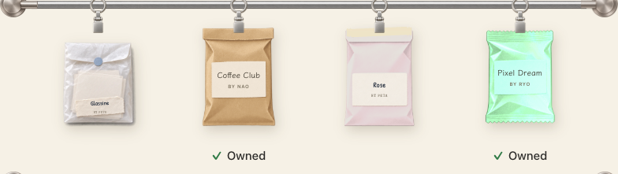
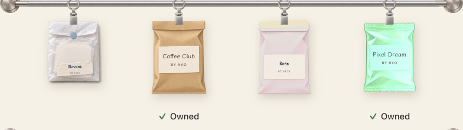
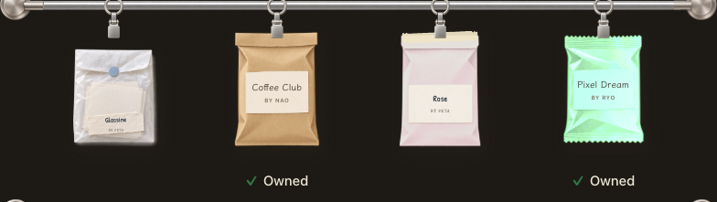
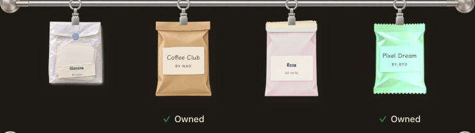
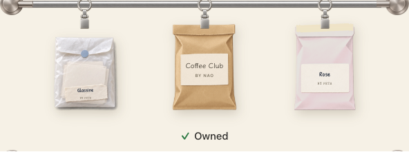
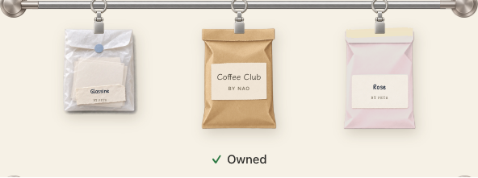
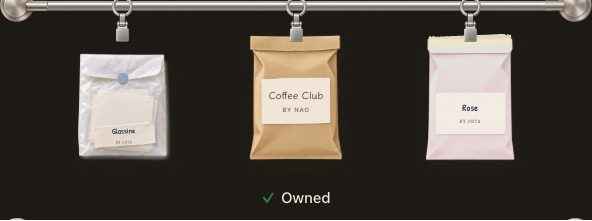
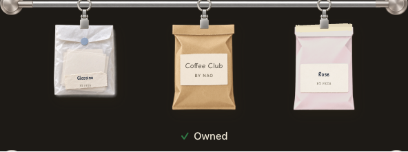

# 報告: 公式パックを、アプリの更新なしで配る

2026-10-16。指示書 [codex-official-packs-prompt.md](codex-official-packs-prompt.md) の作業報告です。**クラウドの Linux 環境**で行いました（§9）。手順は [official-packs-howto.md](official-packs-howto.md)。

## まとめ

| Step | 状態 | コミット |
|---|---|---|
| 1. `shop_pack` の検証と保存・契約ファイル・`peta-pass shop-pack` | 完了 | `6bb1c80` |
| 2. アプリ（取得・保存・ショップ・買う・棚・期間切れ・重み） | 完了（2026-10-17、下の「Step 2 の実装」）。**macOS でのビルドは CI 待ち** | この追記のコミット |
| 3. `peta-api`（`0011`・一覧・トークンつきファイル） | 完了。**dev へのデプロイは未実施** | `a02c4ee` |
| 4. 管理ページ Packs タブ（下書き・掲載）と `shop_config` の拡張 | 完了。**dev へのデプロイは未実施** | `42df1a0` |
| 5. `scripts/sign-pack.sh` | 完了 | `fcf75ad` |
| 6. dev の通し確認 | **未実施**（D1 マイグレーションとデプロイは Claude が行う） | — |
| 7. 手順書・報告 | 完了 | この文書のコミット |

**Mac で未テスト**: 2026-10-16 の時点では、アプリ本体（`src-tauri`）には手を入れていませんでした（10-17 の Step 2 で手を入れた。下の追記）。`peta-core`（ルールと保存）は Linux でもビルド・テストできるので、Step 1 の保存（DB v18）までここで実装・テストしました。macOS の型検査は GitHub Actions の macOS ジョブで行われます。

**デプロイしていない理由**: この環境には wrangler のログインがありません（`wrangler whoami` が未認証）。dev への D1 マイグレーションとデプロイ、Step 6 の通し確認は、オーナーの Mac で行ってください（手順は howto の §2）。

## 作ったもの

### Step 1（`peta-core` / `peta-pass`）

- `src-tauri/crates/core/src/shop_pack.rs`
  - `PETAEVNT` v1、`kind: "shop_pack"`。イベント ID は `shop-<packId>-v<version>`。
  - **公式の鍵（k*）だけ**を信頼する。クーポン鍵で署名されたものは、この検証でも、既存の `events::decode` でも拒否する（テストあり）。`apply_event` は受け取らない（「ショップに出るもので、Gift のようには受け取らない」と返す）。
  - 上限を外れたものは丸ごと拒否: 3〜12枚、4〜40 Scraps、重み1〜100、袋 kraft / matte / holo / glassine、色は matte と holo だけ、題名・作者40字、一行120字、ID は英数字と `-` `_` の40字まで（既存7パックの ID は不可）。
  - 絵: 透明な PNG（透過のある画素と描かれた画素の両方が要る）、長辺 1024px、1枚 1.5MB、合計 12MB。既存の `validate_png`（`image_limits` の上限つき）に加えて検査する。
  - `store()`: 検証してから、絵を `shop/<packId>/<version>/<key>.png` に、中身を新しい表 `shop_packs` に記録する（DB **v18**）。絵の書き込みと DB は同時に確定する（`AssetWrites`）。同じ版の同じファイルは何もしない。同じ版で中身が違うものは拒否する。
  - アプリの中のパック ID は `shop:<packId>`（既存・友達のパックと重ならない）。
- 契約ファイル `cloudflare/shared/shop-pack-contract.json`: 上限・袋と色・レア度と既定の重み・既存の ID。Rust のテストがこれと定数、`catalog.js` の `PACK_BAG_IDS`・`PACK_COLORS` との一致を確かめる。管理ページはこの JSON を直接読む。
- `peta-pass shop-pack --dir <folder> [--key <path>] [--key-id k2] [--out <file>] [--check] [--previous-version N] [--json]`
  - フォルダの `pack.json` と `<key>.png` を検査して署名し、書いたファイルを自分の鍵で検証し直す。
  - `--check` は鍵を読まず、何も書かず、各ステッカーの確率を返す。`--previous-version` はそれ以下の版を拒否する。
  - `verify` は `shop_pack` の上限も当てる。

### Step 3（`peta-api`）

- D1 `0011_shop_packs.sql`
  - `shop_pack_drafts`、`shop_packs`、`shop_pack_tokens`。
  - `shop_packs` には指示書の列に加えて `price`（Shop の値段の範囲の計算用）と `removed_at`（片付けた古い版の印）を足した。既存の表は変えていない。
- `/v1/config` に `shopPacks` を足した。
  - 対象は販売中（開始済み・終了前・停止していない・片付けていない）のパックで、各パックについて販売中の最新版だけ。
  - 中身は `{packId, version, size, sha256, endsAt, url}`。`endsAt` は、オフラインの間も期間切れで隠せるように足した。
- ファイルの配信: `GET /v1/shop-pack/<token>/<packId>/<version>`。
  - トークンは 10 分で、その Mac 専用。保存するのはハッシュだけ。
  - 1回の `/v1/config` の答えに1つだけ作り、販売中のパックがなければ作らない。
  - そのときにも販売中で、保存してある大きさと一致するファイルだけを渡す。
  - 招待が必須の環境では、招待済みの Mac だけ（既存の認証の仕組みのまま）。
  - 期限切れのトークンは定期の掃除で消す。
  - 指示書の `/v1/shop-pack/<token>` にパック ID と版を足した形です（1つのトークンで複数のファイルを取れるようにするため）。

### Step 4（`peta-admin`）

- Packs タブ（`public/packs.js`、`src/packs.ts`）
  - **下書き**: 新しい ID、または署名済みパックの次の版（今の中身と絵から始める）。絵はブラウザで 1024px に縮小し、透過を確かめる。Worker でも PNG のヘッダー（大きさ・透過）と契約の上限を確かめる。プレビューには袋の簡易版、ステッカー、各ステッカー・各レア度の確率を出す。
  - **Ready to sign**: 下書きを凍結し、R2 の下書きのフォルダに `pack.json` を書き、Mac で打つコマンドを表示する（Copy command）。直すときは Duplicate、やめるときは Discard。
  - **署名済み**: 中身は署名済みファイルそのものから読み、文字はプレーンテキスト、絵は `blob:` で表示する。期間（終わりなしも可）、停止、同時に販売中・予定は24まで、確認つきの片付けがある。
  - R2 に書くのは `shop/drafts/` の下だけ。片付けで消すのは `shop/` の下だけ。**ページは署名せず、鍵ファイルを選ばせる UI もない**。
- `shop_config`
  - Featured・並び・値段に署名済みのパック（`shop:<packId>`）を選べる。値段はそのパックの値段の 50〜200%。
  - アプリ側（Rust の `validate_shop`）も `shop:<packId>` を受け付けるようにした（30パックまで、Featured は6まで）。
  - パックの値段はファイルが届くまで分からないので、設定の検査時は 2〜80 の範囲だけを見る。パック自身の 50〜200% は、ショップが値段を付けるとき（Step 2）に当てる。
  - 契約ベクトル（`config-vector.json`）を作り直した（上限の値だけが変わり、署名済みの例は同じ）。
- 新しい変数 `PETA_ENV`（dev / prod）。表示するコマンドの行き先に使う。

### Step 5（`scripts/sign-pack.sh`）

1. オーナーの wrangler ログインで、下書きの行・`pack.json`・絵を一時フォルダに取ってくる。ready でなければ止まる。
2. `peta-pass shop-pack --check --previous-version` で検査する。
3. 取ってきたファイルからプレビューの HTML を作って `open` で開く（外部の読み込みなし、CSP つき）。ターミナルにも要約を出し、`y/N` を聞く。
4. `y` のときだけ `peta-pass` が署名する（prod は k2、dev は k1、鍵は既定で `/Volumes/Peta-private/official.key`）。**鍵ファイルを読むのは `peta-pass` だけ**で、スクリプトはパスを渡すだけ。
5. 署名したファイルを `peta-pass verify` で確かめてから、R2 `shop/<packId>/<version>.peta` に置き、D1 に「署名済み（未掲載）」を記録する。
6. 一時フォルダを消す。

## テスト（このクラウド環境で実行）

| コマンド | 結果 |
|---|---|
| `cargo test -p peta-core -p peta-pass` | 286 + 2 + 6 + 2 件成功（Vision の3件は Linux では対象外）。clippy の警告なし |
| `cargo test -p peta-core --features developer --test official_trust` | 2 件成功 |
| `cd cloudflare/peta-api && npm test && npx tsc --noEmit` | 77 件成功、型検査成功 |
| `cd cloudflare/peta-admin && npm test && npx tsc --noEmit` | 53 件成功（Packs 9 件を含む）、型検査成功 |
| `cd cloudflare/peta-download && npm test && npx tsc --noEmit` | 11 件成功、型検査成功 |
| `npm test` | 250 件成功 |
| `python3 scripts/test-harness.py` | 全ハーネス成功 |
| `python3 scripts/test-sign-pack.py`（新規） | 成功: ready でない下書きは止まる、プレビューは取ってきたファイルから作られる、`n` なら何もアップロードしない、`y` で署名・検証・アップロード・記録、同じ版は拒否、鍵の中身は出力・ログ・プレビュー・アップロードのどこにも出ない |
| `node scripts/check-admin-packs.mjs`（新規） | 成功: 下書き、透明でない絵の拒否、確率、Ready to sign、署名済みの中身（プレーンテキストと `blob:`）、期間、Shop の Featured、**375px** で横スクロールなし |
| `node scripts/check-admin-round2.mjs` | 成功（既存の管理ページに影響なし） |

**実行していないもの**:
- `cargo test --workspace --features server` と `cargo test --workspace`。アプリ本体は Linux でビルドできない。GitHub Actions の macOS ジョブが型検査とアプリの単体テストを行う。
- `python3 scripts/test-release-mac.py`。macOS 専用。

CI（`.github/workflows/ci.yml`）に `test-sign-pack.py` と `check-admin-packs.mjs` を足しました。

空き容量（クラウド環境）は 252 GB 中 19 GB でした。Mac のディスクの話ではありません。

## Mac に残る作業（Step 2・6）

> 2026-10-17: 1〜4 は実装しました（下の「Step 2 の実装」）。残りは 5（k2）と 6（dev の通し確認）です。

1. **取得**（`server` feature）
   - 設定を取得するときに `shopPacks` を受け取り、手元にない `{packId, version}` だけ `url` から落とす。
   - `peta_core::shop_pack::store` で検証・保存する（実装済み）。失敗したら捨てる。
   - `endsAt` を過ぎたものと、一覧から消えたものはショップに出さない（棚の分は消さない）。
2. **ショップ**（`market.js`）: 既存の6パックと並べる。絵は保存した PNG を使う。`shop_config` の Featured・並び・売る売らない・値段がそのまま効く。
3. **買う**（`scraps::pack_offer` / `trade` の `Kind::Pack`）
   - `shop:<packId>` のとき、基準値段は `shop_packs.price`、調整はそのパックの 50〜200%。外れた値段はそのパックについては使わない。
   - 1セットは `pack_items`・`signed_pack_items`（保存した PNG のパス、`material_id` は matte、`finished` は 0）・`pack_item_weights` で入れる。
   - 袋と色は、`pack_distributions` の `pouch` と `pack.color.<id>`。
4. **重みで引く**: `creator_pack::pick` は今、端末の鍵で署名されたパックでだけ重みを使う（公式の `grant_pack` は均等）。ショップのパックで重みを効かせるには、`pack_item_weights` があれば重みで引くように変える必要がある。
5. **k2**: 公開鍵を `KEYS` の末尾に入れた版を配ってから、本番のパックを出す（howto §1）。
6. **dev の通し確認**（Step 6）: dev の管理ページで下書き → `sign-pack.sh <draftId> dev` → 期間を設定 → Peta Developer のショップに並ぶ → 買う → 開ける → 期間を終わらせる → ショップから消え、棚の分は開ける。

## 判断したこと・気をつけること

- **古いアプリと Shop の設定**: アプリはショップの設定を上限の外なら丸ごと無視する。これまでのアプリは `shop:<packId>` を知らないので、新しいパックを名指しした設定を受け取ると内蔵のショップに戻る（壊れはしない）。友達のアプリが Step 2 の入った版に更新されてから、新しいパックを Featured にしてください。howto と管理ページの手順に書いた。
- **透過の確認**: 管理ページの Worker は PNG のヘッダーまでしか見ない（透過できる形式か）。画素まで見るのはブラウザ（下書き時）と `peta-pass`（署名時）とアプリ（受け取り時）。
- **プレビューの袋**: 管理ページはアプリの袋の絵を持たないので、色つきの紙の簡易版。正確な見え方は署名の前に Mac のプレビューと、dev のアプリで確かめる。
- **同じ版の下書きが2つ**: Duplicate した下書きは同じ版のまま。先に署名したほうが通り、もう一方は `--previous-version` で止まる。

## Step 2 の実装（2026-10-17 追記）

§5 と §7 の Step 2、上の「Mac に残る作業」の 1〜4 です。これもクラウドの Linux 環境で行いました。

### 作ったもの

- **一覧と取得**（`src-tauri/src/daily_supply.rs`、`server` feature）
  - `/v1/config` の `shopPacks` を受け取り、`shop_pack::replace_listing` で一覧を丸ごと置き換える（`shop.listed` に `url` を除いて保存。24件まで、ID・版・大きさ・SHA-256 の形を確かめ、読めない一覧なら前の一覧のまま）。
  - 手元にない `{packId, version}` だけ取りに行く。`url` からはパスだけを使い、`/v1/shop-pack/<64桁の小文字16進>/<packId>/<version>` の形でなければ取らない。ホストは使わず、いつもの署名つきの要求で自分のサービスへ。
  - 取ったファイルは `shop_pack::store_listed` で、大きさ・SHA-256・パック・版が一覧どおりで、公式の鍵で確かめられたときだけ保存。失敗したら何も残さず、次のチェックでやり直す。
  - 終わったら `daily-changed` を出し、画面が読み直す。
- **ショップに出すもの**（`peta-core` の `shop_pack::live`）: 一覧にあり、`endsAt` を過ぎておらず、その版を保存してあるもの。`scrap_status` の `shopPacks` と、`packs` の値段（`shop:<packId>`）に入る。
- **値段**（`shop_pack::offer`）
  - 基準は署名した値段。
  - `shop_config` の値段は、その 50〜200% のときだけ使う。外れたらそのパックは署名した値段のまま。
  - 売る・売らないは `shop_config` に従う。
- **買う**（`scraps::trade` → `shop_pack::add_sets`）
  - 1セットごとに `pack_items`・`signed_pack_items`（保存した PNG、matte、`finished` 0）・`pack_item_weights` を入れる。
  - 題名・作者・袋（`pack_distributions`、`official`）・Market の一行（`pack_dress`）・色（`pack.color.<id>`）も入れる。
  - 棚の上限 100 枚はほかのパックと同じ。
  - 期間が終わる・一覧から消えると買えなくなるが、棚の分は開けられる（テストあり）。
- **重みで引く**（`creator_pack::pick`）: これまでは端末の鍵で署名したパックだけが重みを使った。未開封の品に `pack_item_weights` があれば、公式のパックでも重みで引くようにした。重みのないパック（内蔵の6パック・`grant_pack`）は今までどおり均等。
- **絵**（`src-tauri/src/packs.rs` の `shop_pack_picture`）
  - 販売中で保存してあるパックの、署名に入っている絵だけを返す。長辺 512px に縮めて返す。
  - 権限は `allow-signed-distribution` に足した。
- **画面**
  - `market.js` の `ShopPacks`: 内蔵の6パックのあとに並べる。`shop_config` の並び・Featured・一行がそのまま効く。
  - 絵は `shop_pack_picture` から一度だけ取り、フチは画面で付ける（内蔵のパックと同じ）。出す3枚は common → uncommon → rare の順で、レアは見せない。
  - glassine の袋と、色つきの matte・holo は、棚と同じ `BagPic` で描く。ふつうの袋は今までどおり。
  - 棚（`packs.js`）: 保存した絵をのぞき窓に出す。glassine は棚でも glassine で描く。

### テスト

| 確認 | 結果 |
|---|---|
| `cargo test -p peta-core -p peta-pass` | 290 件 通過（増えたテスト: 一覧と取得・期間切れ／買って棚に入り、期間後も開けられる／値段は 50〜200% だけ／重みで引く） |
| `cargo test -p peta-core --features developer,daily-tables` | 292 件 通過 |
| `cargo clippy … -D warnings` | 警告なし |
| `npm test` | 254 件 通過（`tests/shop-packs.test.mjs` を追加: 並び・Featured・絵の順と一度だけの取得・袋・カード） |
| `python3 scripts/test-harness.py`（`packs.rs` を偽の Tauri で） | 通過 |
| ブラウザの確認（`check-csp`・`check-responsive`・`check-boards`・`check-ui-feedback`・`check-updater-ui`・`check-admin-packs`）、`test-sign-pack.py` | 通過 |
| Market に glassine・rose の matte のパックを置いた画面（偽の IPC、手元のスクリーンショット） | 目で確認 |

**macOS で未確認**: `daily_supply.rs` は macOS でしかビルドできないので、ここでは型検査できていません。GitHub Actions の macOS ジョブ（`cargo check`、`cargo test -p peta`）で確かめます。`only_the_services_shop_pack_path_is_ever_fetched` もそこで動きます。

### 気をつけること

- **一覧が届くたびに `daily-changed`**: 6時間ごとのチェックで `shopPacks` が来たら、変化がなくても画面を一度読み直す。軽いので、比べる処理は入れていない。
- **glassine の Market の見え方**: 棚と同じ絵を吊るしているので、クリップと袋の上端に少し隙間がある。気になれば Market 用の位置を足す。
- **残り**: k2 を `KEYS` に入れた版の配布（howto §1）と、Step 6（dev の通し確認）。Step 2 が入った版が友達に届くまでは、新しいパックを Featured にしない（howto §5 の注意のまま）。

## Mac での仕上げ（2026-10-17）

### Step 1: グラシンの吊り下げ

原因は `PackArt.shelf` が袋の底を棚にそろえる配置を Market でも使うこと。グラシンの絵は正方形で、描かれた上端は画像高の約11.7%の位置にあるため、クリップの下端から約11px離れていた。`native.css` に Market の rail 内の `data-bag="glassine"` だけを `16cqw`（この表示では約18px）持ち上げる規則を追加した。棚・Featured・ズームや、kraft・Rose の位置は変えない。

`node scripts/check-market-hanging.mjs --before` と通常実行で、隔離IPCに公式パックを並べ、1060px／720px、昼／夜を確認。クリップと上端が約6px重なり、kraft・Rose の座標は前後で一致した。測定値は [before](official-packs-finish/step1/before-geometry.json) / [after](official-packs-finish/step1/after-geometry.json)。

| 条件 | 修正前 | 修正後 |
|---|---|---|
| 1060px・昼 |  |  |
| 1060px・夜 |  |  |
| 720px・昼 |  |  |
| 720px・夜 |  |  |

### Step 2: dev での通し確認

オーナーの Mac で dev の D1 `peta-dev` / R2 `peta-downloads-dev` を使用。本番、Access の設定、本物の公式鍵には触れていない。`peta-api-dev` と `peta-admin-dev` のみデプロイした。

管理 API は [official-packs-dev.cjs](../scripts/official-packs-dev.cjs) で実行した。`handle()` そのものを読み込み、`test/helpers.ts` と同じ RSA JWT・注入できる cert key source を使い、Wrangler `getPlatformProxy` の **remote: true の dev D1/R2** に接続した。認証の差し替えはこのローカル検証スクリプトだけで、Worker の配布コードに認証回避は追加していない。起動は `node scripts/official-packs-dev.cjs --dev`、127.0.0.1:8789 限定。Access 未設定の公開管理ページは引き続き403。

試験 ID は `mac-finish-oct17`。既存の透過PNG `cat-skateboard.png` / `coffee-cup.png` / `blue-flower.png` を使用した。v1 は glassine・12 Scraps・重み4:2:1、v2 は matte/Rose・12 Scraps・100:1:1。`sign-pack.sh` を両版で実行し、ダウンロードしたプレビューを確認してから `y` を入力。署名したのは公開済み RFC8032 テスト鍵 k1 のみ。

| 段階 | 結果・記録 |
|---|---|
| 下書き → Ready | 実際の Worker の作成・保存・PNG upload・Ready API が成功。[管理画面](official-packs-finish/step2/ready.png) |
| Mac の署名 | v1/v2 とも検査・プレビュー・k1署名・アップロード成功。[v1](official-packs-finish/step2/sign-v1-preview.png) / [v2](official-packs-finish/step2/sign-v2-preview.png) |
| 掲載 | 実際の publish API で「今から1日」を設定。[管理画面](official-packs-finish/step2/published.png) |
| 取得 | dev の `/v1/config` と Mac 専用短命トークンのファイル取得成功、SHA256一致。[v1一覧](official-packs-finish/step2/config-v1.json) / [v2一覧](official-packs-finish/step2/config-v2.json)。通常版の `peta-pass verify` がk1を拒否することも確認（署名スクリプトは明示した公開鍵で再検証して成功）。 |
| Market | 実際の Developer にv1のグラシン、v2のRoseが順に届いた。題名・紹介文・袋・色が一致。[v1](official-packs-finish/step2/market-v1.png) / [v2](official-packs-finish/step2/market-v2-rose.png)。今回のパックをFeaturedには指定せず、既存設定を維持。 |
| 購入 → 棚 | 1セットで3枚、10セットで30枚を追加。[購入画面](official-packs-finish/step2/buy-v1.png) / [v1の棚](official-packs-finish/step2/shelf-v1.png) / [v2の棚](official-packs-finish/step2/shelf-v2.png)。Developer の仕様どおり「Free (developer)」、残高53は不変。通常版の12 Scraps課金はRustの価格・残高テストで確認。 |
| 開封 → Keep | [グラシンを開ける](official-packs-finish/step2/open-glassine.png) → [保護紙](official-packs-finish/step2/peel-cover.png) → [判子・Keep](official-packs-finish/step2/reveal-keep.png)。Collectionへの保存を確認。Roseは[上端を破る操作](official-packs-finish/step2/tear-rose.png)も確認。取り出し・はがしは実装済みのダブルクリック／Enterでも進めた。 |
| 重み | v2を10セット買い、実機の「Open 10」で抽選。**猫9枚、青い花1枚**。[結果画面](official-packs-finish/step2/weighted-ten.png) / [開封した実データ](official-packs-finish/step2/weighted-ten.json)。未開封から重みつき・非復元で引くので、残りを引くほど比率は変わる。 |
| 期間終了 | 修正後のWorkerで両版の終了を過去に変更でき、[管理画面](official-packs-finish/step2/ended-admin.png)と[実際のdev一覧が空](official-packs-finish/step2/config-ended.json)で確認。旧版が販売中だと最新版終了後に旧版が戻るため、両版を終了した。 |

Developer に即時取得ボタンがないため、検証中は `daily.table_attempt` の値だけを退避して0にし、アプリを開き直した。既存のDeveloperライブラリで確認し、オーナーの既存パックは購入・開封していない。Tauri の developer コンテキストが識別子を固定するため、CLIでの識別子上書きはライブラリ分離に使えない。

`npm run dev:developer` はビルド・起動成功。ただしCLIの一時HTTP配信に依存する実行ファイルを単独で使った画面確認では[白画面](official-packs-finish/step2/developer-blank.png)になった。実機確認は `tauri build --debug --features developer --bundles app --no-sign --config src-tauri/tauri.developer.conf.json` のアセット内蔵バンドルと、既存の debug 専用 `PETA_PORT_CAPTURE_DIR` を使用した。配布はしていない。

### 通し確認で直したもの

- 管理APIが過去の終了日時を拒否していた（実際のWorkerで400を再現）。開始より後という検査を維持し、過去の終了日時を受け付けるようにした。「ended」になることと、不正な逆転期間の拒否を既存テストに追加した。
- 開封応答が素材のレア度を使い、公式パックのCoffee（署名ではuncommon）やBlue Flower（rare）も、matte素材のcommonと表示していた。公式ショップパックだけ署名済み `StoredItem.rarity` を返すようにした。Creatorパックの素材基準の扱いは維持し、uncommon／rareのmatteとCreatorの回帰テストを追加した。上の初回スクリーンショットのcommon表示は修正前の記録。
- 6時間ごとの取得に関する `183786d` の抑制処理は維持。`replace_listing` はURLを保存・比較から除き、一覧が同じならfalse、新規取得もなければ `today::announce` を呼ばない。既存の「same list again is not a change」「取得は一度だけ」テストを含むRustテストが通過。**実時間で6時間待つ確認は行っていない**。

### 終了後の実機確認と片付け

- [Market から消えた画面](official-packs-finish/step2/market-ended.png)でも、[棚の22枚](official-packs-finish/step2/shelf-ended.png)は残った。無料開封のCoffeeが修正後の **Uncommon** と表示されることを実機で確認した（[画像](official-packs-finish/step2/ended-open-uncommon.png)）。さらに通常の封も開け、**22 → 21枚**になった（[画像](official-packs-finish/step2/ended-normal-open.png)）。
- Stick it から[ネイティブ印刷レイヤー](official-packs-finish/step2/stick-it-print.png)へ渡ることを確認した。最終的なデスクトップへのドラッグは、画面操作ツールが透過レイヤーをつかめず `windowNotFoundAtPosition` となり未確認。印刷待ちは Later で閉じ、ステッカーはCollectionに残した。実際の最終貼り付けは今回の未確認項目。
- dev D1 の試験パック2版・下書き2件、R2の試験パックと下書きの計10オブジェクトを削除した。対象は自分の ID / draft ID の prefix に限定し、管理ページの一括 cleanup は使っていない。[削除前](official-packs-finish/step2/cleanup-before.json) / [削除後（行・オブジェクトすべて0）](official-packs-finish/step2/cleanup-after.json) / [管理画面](official-packs-finish/step2/cleaned-admin.png)。公開dev管理APIが403のままであることも再確認した。
- ローカルDeveloperには試験で買った残り21枚と開封済みステッカーを残した。既存のパック・ステッカーを消していない。検証用に退避した `daily.table_attempt` は元の値へ戻した。試験用ローカルWorkerと自分が起動したアプリは停止した。

### 最終テストとディスク

`CARGO_INCREMENTAL=0` を使用。修正後の再実行も通過した。ログはMacの `/tmp/peta-finish-tests-*.log`。

| テスト | 結果 |
|---|---|
| `cloudflare/peta-api`: `npm test` / `npx tsc --noEmit` | 77件・型検査成功 |
| `cloudflare/peta-download`: 同上（元指示書§8） | 11件・型検査成功 |
| `cloudflare/peta-admin`: 同上 | 修正後53件・型検査成功 |
| `cargo test --manifest-path src-tauri/Cargo.toml --workspace --features server` | app 29件成功・既存3件ignored、core 293件、統合・CLIテスト成功 |
| `cargo test --manifest-path src-tauri/Cargo.toml --workspace` | app 16件・core 293件、統合・CLIテスト成功 |
| `cargo test --manifest-path src-tauri/crates/core/Cargo.toml --features developer --test official_trust` | 2件成功 |
| `npm test` | 修正後262件成功 |
| `python3 scripts/test-release-mac.py` | 4項目成功（署名等はmock） |
| `python3 scripts/test-sign-pack.py` | 成功（fake Wrangler） |
| `node scripts/check-admin-packs.mjs` | 成功（stub API・375pxを含む） |
| `node scripts/check-market-hanging.mjs` | 成功（昼夜・1060/720px・他の袋の座標不変） |
| Developer debug バンドル | macOSでビルド成功、実機で購入・開封・期限終了後の開封成功 |

ディスクは開始時30GiB、最終計測24GiB空き（228GiBのボリューム）。`npm run clean:target` で対象を確認後、`npm run clean:target -- --apply` で古いビルドのオブジェクト4302件・2.82GBを削除した。今回必要なdebugビルドは残している。

オーナーの保護対象5ファイル（`creator.rs`・`ceremony.js`・`create.js`・`market.js`・`tests/create-picker.test.mjs`）は、開始時と最終のSHA256がすべて一致。自分が変更したファイルだけをコミットした。本番のk2準備・配布は今回の範囲外のまま。
