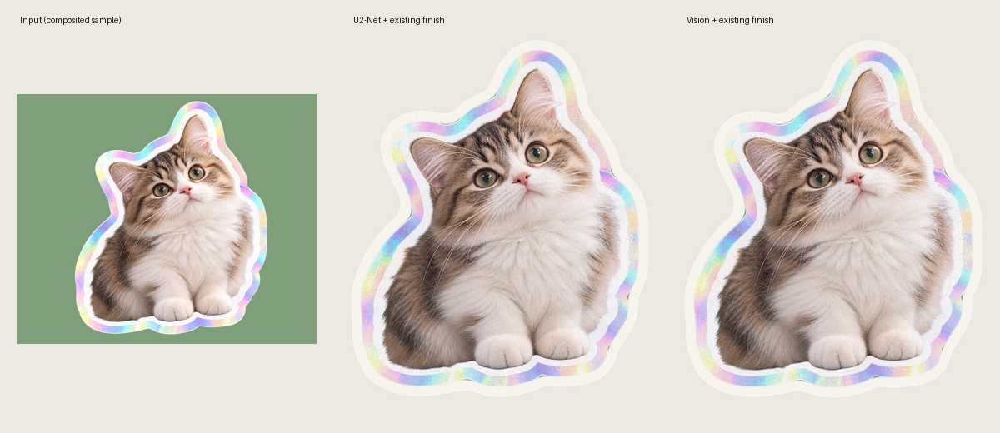

# Vision 切り抜きの実装報告（2026-10-11）

## 実装

- `segment.rs` を Apple Vision の前景抽出へ置き換えた。`objc2` 0.6 / `objc2-vision` 0.3.2 で Rust から直接呼ぶ。
- sRGB の CGImage → `VNGenerateForegroundInstanceMaskRequest` → `allInstances` → 入力サイズの scaled mask。8-bit と 32-bit float の CVPixelBuffer を扱い、行の余白を考慮してコピーし、RAII で必ず unlock する。
- macOS 14 未満を実行時にも拒否。通常版・開発者版の最低 OS は 14.0。無地・空の前景は `Nothing was cut out. Try another picture.` とする。Vision のエラーは元の説明を保持する。
- native オブジェクトは従来の `spawn_blocking` の中だけで生成・破棄する。Session のマスク以降（edge snapping、ブラシ、Erase / Restore、輪郭、素材）は変更しない。
- tract の依存、モデルファイル、モデル選択、埋め込みを削除。透明画像は従来どおり alpha を使う。

## 方式のスパイク

両案を、この Mac の既存サンプル画像から作った不透明画像でコンパイル・実行した。Swift の小さい C ABI スパイクは一時フォルダだけに置き、製品には残していない。

| 方式 | 結果・速度 | コードと保守 |
| --- | --- | --- |
| A: typed objc2 | 必要な request / observation / scaled mask の型が揃い、コンパイル・実行成功。下記の Rust 計測で確認 | Rust 内の1モジュール、型付きの retain と RAII。追加の native build が不要 |
| B: Swift + C ABI | 1374×1145 の scaled mask を取得できた。OS モデル初期化を含む最初の実行は4.09秒。その後のプロセスでは0.295 / 0.045 / 0.050秒 | スパイクは約25行だが、製品では build.rs、C ABI、バッファ所有権、リンク処理が別途必要 |

**A を採用**。両案とも Vision の同じ API を呼ぶため、言語だけで速さが決まるとは判断しない。Rust 計測は入力の縮小・マスクの拡大も含み、Swift の数値とは処理範囲が異なる。

API 確認: [Apple の request](https://developer.apple.com/documentation/vision/vngenerateforegroundinstancemaskrequest)、[objc2 の observation](https://docs.rs/objc2-vision/0.3.2/objc2_vision/struct.VNInstanceMaskObservation.html)。

## 計測・画像比較

- 環境: Apple Silicon、macOS 27.0。実際の12MP写真はリポジトリにないため、既存の猫を背景に合成して4000×3000へ拡大した**テスト画像**を使用。
- `segment` example（長辺2048へ縮小 → Vision → 4000×3000へマスクを補間、元画像は保持）: **0.780 / 0.564 / 0.532秒**。OS モデルがまだ初期化されていない最初の起動は別途遅くなりうる。
- 通常の Creator（940px 作業コピー）: 同じ猫の旧方式は解析0.604秒・描画0.255秒、Vision は解析0.309秒・描画0.213秒。仕上げの寸法は旧648×776 / 新647×776、coverage はどちらも43%。

比較画像を目視した範囲では、輪郭や耳・足の形に目立つ劣化はない。ただし元サンプル自体に縁があるため、**実際のひげ・髪・細い腕の品質の受け入れは未確認**。オーナーの写真で確認する。

## 検証

- `cargo test --manifest-path src-tauri/Cargo.toml --workspace`: core 151件、app 5件、pass 5件、pass integration 1件、全成功。
- Vision: busy background の被写体（IoU > 80%）、面積5〜95%、全面塗りでない端、2回の一致、EXIF 回転、白・黒の無地、輪郭とブラシの回帰テストが成功。
- `npm test`: 129件成功。
- 初回ビルドは既存の成果物による容量不足で停止した。付属 `clean-target.py` で古い成果物を整理し、再実行で成功。Vision 実行には sandbox 外の Neural Engine アクセスが必要だった。
- `CARGO_INCREMENTAL=0 npm run build -- --debug`: **Peta.app 71.98 MiB**、成功。Tauri が既存の `Graphics` カテゴリを拒否したため、対応する `Graphics and Design` に修正した。完成したバンドルに ONNX ファイルはない。変更前の `.app` が保存されていなかったため、同条件の `.app` サイズ差は未計測（モデル本体4.5MBと tract の依存は削除済み）。release サイズは、この debug 計測とは別。

実機操作の項目は `docs/port-spec/macos-checklist.md` に追加した。

## Mac 専用化（別コミット）

- Windows の platform スタブ、非Macの link tag 代替処理、Windows の起動・コンソール設定、OS 分岐を削除。Vision の native モジュールと依存は Mac 前提に整理した。
- README の現在の対応 OS・検査コマンドを更新。`docs/port-spec/README.md` の冒頭で、過去の非Mac記述は参考資料と明示した。
- `CARGO_INCREMENTAL=0 npm run check:mac` は成功。
- Mac 専用化後にも `cargo test --workspace`（core 151件ほか）と `npm test`（129件）を再実行し、全成功。
- `.app` の Info.plist の `LSMinimumSystemVersion` は **14.0**。

## 最終 release ビルド

3つの実装を含む `CARGO_INCREMENTAL=0 npm run build` は成功。Peta.app は **53.10 MiB**、Info.plist の最低 OS は **14.0**、ONNX ファイルは0個。変更前の同条件バンドルとのサイズ差は未計測。
